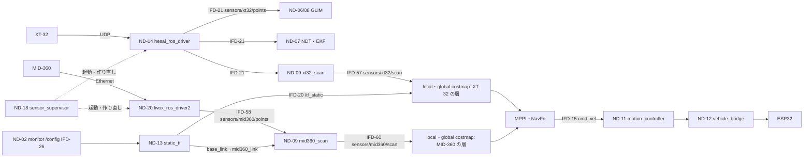
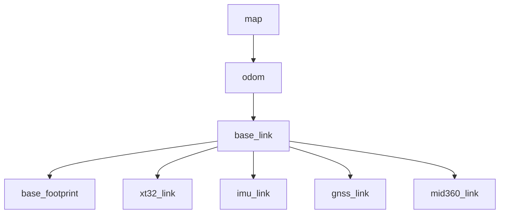

# MID-360 搭載版のシステムアーキテクチャ（提案、2026-11-06）

状態：**提案**。承認された仕様ではなく、実装していない。番号 ND-20・IFD-58 などは仮で、正本に入れるときに reserve_ids で取り直す。

前提にしている未回答の項目：取り付けの高さ（DEC-425、500 mm か 800 mm）、前後の位置（未回答）、MID-360 の印の消し方（#35、#76）、自己位置に使うか（#72 の判断 2）、MID-360 がないときの扱い（下の A-6）。回答で前提が変わったら作り直す。

根拠：intent.md（障害物の検出は XT-32 と MID-360、センサーの TF は /config）、#72（統合の計画）、#74（見える範囲）、#76（低い物の印）、`design/docs/lidar_xt32_spec.md`。

## 1. 変えるもの・変えないもの

| 要素 | 今 | MID-360 搭載版（案） |
|---|---|---|
| ND-14 hesai_ros_driver（XT-32） | そのまま | そのまま |
| **ND-20（新）livox_ros_driver2（MID-360、外部）** | — | 点群を IFD-58 に出す。ND-18 が起動・作り直し |
| ND-18 gouda_sensor_supervisor | XT-32・IMU・GNSS | MID-360 を足す（XT-32 と同じ作り。設定ファイルは generated/params から作る） |
| ND-13 gouda_static_tf | base_link → xt32_link・imu_link・gnss | base_link → **mid360_link** を足す（/config から） |
| ND-02 gouda_monitor | /config の lidar・imu の欄 | **mid360_mount_*** の欄、MID-360 の状態の表示 |
| ND-09 障害物の扱い | xt32_scan（帯を base_link で切る） | **mid360_scan** を足す。帯の切り方は #76 の結果で決める |
| ND-10 Nav2 | local・global に XT-32 の ObstacleLayer 1 つ | MID-360 の層を足す（下の 3 章）。値は模擬で決める |
| ND-04 gouda_recorder | rosbag の対象 | MID-360 の点群・scan を足す |
| ND-06〜08 自己位置（GLIM・NDT） | XT-32 | **変えない**（案。自己位置に使うかは別の判断） |
| setup.sh・drivers.repos | — | Livox-SDK2 と livox_ros_driver2 の版を固定して足す（ばらばらの手順にしない） |

## 2. データの流れ

## 3. costmap の層（候補。模擬で選ぶ）

| 案 | XT-32 | MID-360 | 低い物の印を消す光線 | 関連 |
|---|---|---|---|---|
| B0（同じ層） | 印・消去 | 印・消去 | 両方（XT-32 が低い物を消す） | 比較用 |
| B1（別の層） | 層 1：印・消去 | 層 2：印・消去 | MID-360 だけ | #35 |
| B2（高さで分ける） | 高い層（約 1.0 m 以上）：印・消去／低い層：印だけ | 低い層：印・消去 | MID-360 だけ | #76 案 1 |
| B3（3 次元） | VoxelLayer：印・消去 | 同じ VoxelLayer：印・消去 | 光線が通った格子だけ | #76 案 2、DEC-321・336 の見直し |
| B4（時間） | 上のどれか | 印を数秒で減衰 | 時間 | #76 案 3（STVL は MID-360 の非対称の視野を表せない） |

- 足跡の中の点（車体の写り込み）は Nav2 の足跡の消去で消える見込み。はみ出す部品は切り取りの箱を足す（値は取り付けの後）
- 印を付ける距離（PRM-125・126）は MID-360 の層も同じ値から始める（#34）

## 4. TF

- mid360_link は /config の値（人が入力）から ND-13 が出す。値の求め方は #72（地面の当てはめ・内蔵 IMU・XT-32 との位置合わせ）
- livox_ros_driver2 の設定ファイルの外部パラメータは使わない（TF の発行元を 1 つにする）

## 5. 1.8 の対応（案）

| モジュール | 内部コンポーネント | ROS node | プロセス |
|---|---|---|---|
| M-023 障害物認識 | MID-360 の点群の取得 | livox_ros_driver2（ND-20） | ND-18 が起動する別のプロセス（XT-32 のドライバと同じ） |
| M-023 障害物認識 | MID-360 の高さの帯 | mid360_scan（ND-09） | Nav2 と一緒に起動（xt32_scan と同じ） |
| M-011 Navigation | MID-360 の層 | controller_server・planner_server の costmap | 今と同じ |

## 6. 判断が要ること（未登録。登録は人の回答の後）

| # | 内容 | AI の推奨 | 止まる作業 |
|---|---|---|---|
| A-1 | 取り付けの高さ | 500 mm（#74：前方の近くが見える） | ドライバより後のすべて |
| A-2 | 前後の位置 | 足跡の前端（計算の前提） | 写り込みの切り取り |
| A-3 | 層の構成 | 模擬で B0〜B4 を比べてから | Nav2 の設定 |
| A-4 | 自己位置に使うか | 使わない | なし（使う場合は別の設計） |
| A-5 | MID-360 の内蔵 IMU | 使わない（外部パラメータの確かめにだけ使う） | なし |
| A-6 | MID-360 がない・止まったとき | 動き続ける（XT-32 だけで走り、記録と表示）。リスク：低い物が見えない | sensor supervisor・Nav2 の起動の条件 |
| A-7 | ネットワーク | スイッチか別の口かを人が決める | ドライバの設定 |
| A-8 | 時刻の合わせ方 | 受信の時刻のまま始め、ずれを rosbag で測る | 動く物の印 |

## 7. 見落としとして指摘すること

- 横・後ろの近くは MID-360 でも見えない（#74）。後退の回復（BackUp）と、その場の旋回（Spin）の扱いと一緒に決める必要がある（#27、#44）
- 車速 0 からの無駄時間（#57）は、前が見えても動き出しを遅らせる
- 電源（起動時 18 W）、放熱（#31）、雨・日差し・黒い物の返り（XT-32 も未確認）
- x86 の CPU と DDS の負荷：点群がもう 1 本。未測定
