# 地面分割の比較（G2：記録と合成の場面での比較、2026-11-07）

- 状態：調査の結果（材料）。どちらの方式を採るかは書かない。採否は人が決める（DEC-475 の G3）。製品のコード・設定は変えていない
- 人の指示（原文、DEC-475）：「地面はRANSAC等を用いたOSSを使って検出しよう。閾値設定だけでは障害物がないのにあると誤検知してしまうかもしれません。」
- 許可：DEC-475（`design/revisions/REV-259.yaml`）の G2（記録での比較）
- 読んだコミット：9c449b5。作業ツリーは他のセッションと共有で、`design/generated/params/gouda_nav2.yaml` は未コミットの変更があったが、PRM-70・71 の値は HEAD と同じ（−0.065 m・1.085 m）
- 案：K-yama-20/tsukuba-autonomous-robot#85。同じフォルダの `survey.md` は別の流れ（G1）のもので、ここでは読んでも書いてもいない
- 道具：`tools/`（比べ方の本体と単体テスト）。図：`figures/`（集計の図と、1 枚の点群の図だけ。点群・rosbag の生データは置いていない）

## 1. 要点（数値。良し悪しの判断はしない）

- 合成の場面（正解あり）
  - 帯だけ：取り付けの pitch の誤差が ±1〜2°（比較用の仮定）あると、平らな地面でも 3〜6 m の地面が印になった（1 枚あたり、全 360 方位のうち、XT-32 で 21.4〜125.8 方位、MID-360 で +1〜+2° のとき 9.5〜107.5 方位）。4.5° の上り坂（2 m 先から、比較用の仮定）では誤差 0° でも 106.6〜113.5 方位
  - 2.5 m 以内（Nav2 の雛形の obstacle_max_range。これより遠い印は costmap に入らない）の地面の印が 1 枚あたり 1 方位を超えたのは、帯だけの MID-360 の上り坂で +2° のとき（18.4・24.2 方位）だけ。他の条件は 0〜0.4。XT-32 は 4 m より近い地面が見えないので 0
  - Patchwork++＋帯：上の地面の印は全条件で 0。linefit＋帯：XT-32 の上り坂で +2° のとき 6 m 以内に 26.8 方位、他は 1.5 以下
  - 見落とし（高い物）：コーン（0.70 m）・箱（0.15 m・0.30 m）・脚（0.80 m）は、帯だけで印になった枚では、地面分割の後もほぼ印が残った（帯の中の障害物の点の 0〜46 % が地面にされた）。例外は 1 枚ずつ：MID-360 0.5 m・上り坂・0° の Patchwork++ で 0.15 m の箱（2.4 m）が 19/20 枚（帯だけ 20/20）、MID-360 0.5 m・平地・−2° の linefit で同じ箱が 9/20 枚（帯だけ 10/20）
  - 見落とし（縁石・段差）：地面分割で印が消えることがあった。MID-360・誤差 0° で、前の縁石 10 cm は帯だけ 20/20 枚、Patchwork++ 0/20（0.5 m）・2/20（0.8 m）、linefit 20/20。左の段差 10 cm は帯だけ 20/20、Patchwork++ 4/20・5/20、linefit 7/20・20/20
  - 帯だけでも、pitch の誤差が −2° だと、MID-360 の前の縁石は 15 cm でも印にならなかった（0/20）
- 実データ（XT-32、屋外の手動の地図作成の記録、坂を含む 2 区間・計 542 枚、正解なし）
  - 2.5 m 以内では、3 方式の印は全枚数で同じだった
  - 6 m 以内では、帯だけにあって地面分割の後に消える（または 0.10 m より遠くなる）方位が、1 枚あたり平均 Patchwork++ 52〜56・linefit 23〜30
  - 消えた印の 95 % 以上は、近くの一番低い点群から 0.15 m 未満の高さだった（地面らしい。目安で正解ではない）。0.15 m 以上は Patchwork++ で 1.9 %・4.9 %、linefit で 1.8 %・1.7 %。どれが本当の物かは人が図で確かめる必要がある
- 処理の時間（ワークステーション、Python から 1 枚）：XT-32 の 1 枚（約 6 万点）で Patchwork++ 中央値 3.2〜3.5 ms、linefit 4.9 ms。車載 PC では測っていない

## 2. 比べ方

### 2.1 写した上流の振る舞い（pointcloud_to_laserscan 2.0.2）

今の印は、上流の `pointcloud_to_laserscan` の node（xt32_scan・mid360_scan。ND-09・ND-21、IFD-57・IFD-60）が作る。その `cloudCallback` を numpy で写した（`tools/p2l.py`）。読んだ原本：ros-perception/pointcloud_to_laserscan の tag 2.0.2 の `src/pointcloud_to_laserscan_node.cpp`（Apache-2.0。下の行番号はこのファイル）。Gouda が与える値は `gouda_core/gouda_core/nav2_config.py` の `scan_parameters()`。

| parameter | Gouda の値 | 上流の扱い（行） | 写し方 |
|---|---|---|---|
| target_frame | base_link | 点群を tf2 で変換してから使う（166〜176） | 呼ぶ側が変換する。`geometry.transform_points` は tf2_sensor_msgs と同じく float32 で計算 |
| min_height・max_height | −0.065・1.085 m（PRM-70・71） | z > max または z < min を捨てる。両端は残す（191） | 同じ。z は float32、閾値は double で比べる（float32 の 1.085 は 1.08500004 になり捨てられる。テストで確認） |
| range_min・range_max | 0.0（既定）・6.0 m | 距離は target_frame の hypot(x, y)。範囲の外を捨てる（199〜213） | 同じ。6.0 m は雛形の obstacle_max_range 2.5・raytrace_max_range 3.0 の大きい方の 2 倍（`scan_range_max()`） |
| angle_min・angle_max・angle_increment | −π・π・既定の π/180 | LaserScan の float32 の欄に入れてから、本数 = ceil((max − min) / increment) を float32 で計算（147〜157）。bin = int((atan2(y, x) − angle_min) / increment)（215〜225） | 同じ（本数 360） |
| 方位ごとの一番近い点 | — | bin の値より近ければ置き換える（226〜228） | 同じ（値は float32 で持つ） |
| use_inf・inf_epsilon | true・既定 1.0 | 点のない bin は +inf（160〜164） | 同じ |
| NaN | — | 捨てる（183） | 同じ |

写していないもの（範囲の値に効かない）：購読のスレッド、queue_size、transform_tolerance、scan_time、header。

上流の端の扱いで気づいたこと（事実。コードを読んで計算した）：float32 の π/180 は π/180 より少し小さいため、方位が +π から 1.36×10⁻⁷ rad 以内の点は bin 番号が 360 になり、長さ 360 の配列の外を読み書きする（226〜227、C++ では未定義の動作）。その点は出力の scan に入らない。写しではその点を捨てた（`tests/test_p2l.py` で確認）。

### 2.2 比べる 2 つの方式

- 帯だけ：base_link の点群 → 帯（2.1）→ 方位ごとの一番近い点。今の製品と同じ
- 地面分割＋帯：base_link の点群を「base_link の軸のまま原点をセンサーに移した座標」に置き → OSS が地面とした点を除く → 残りを同じ帯に通す
  - 地面分割は点を除くだけなので、印が増えることはない。印が消えるか、遠くなるかだけ
  - base_link は車体の向きで、重力の向きではない。坂の上や取り付けの誤差があると、この座標もその分だけ傾く（#85 の「重力に近い frame」は使っていない）

### 2.3 使った OSS と版（自作していない）

| 項目 | Patchwork++ | linefit |
|---|---|---|
| 入手 | PyPI `pypatchworkpp==1.4.1`（wheel、cp312 manylinux） | PyPI `linefit==1.1.0`（wheel、cp312 manylinux） |
| 上流 | url-kaist/patchwork-plusplus の tag v1.4.1（commit 3e6903a1d5537a4cc2ace897b0bbb98a92d6014c） | Kin-Zhang/linefit の tag v1.1.0（commit 892386191be232022b124cc59ad2c1e47e3d5dcf）。C++ は lorenwel/linefit_ground_segmentation（Himmelsbach 2010） |
| ライセンス | BSD-2-Clause（tag v1.4.1 の LICENSE 本文を読んだ） | BSD-3-Clause（wheel 同梱の LICENSE を読んだ） |
| 変えた値 | sensor_height（センサーの地面からの高さ）。MID-360 だけ min_range 0.2 m | height（同）。MID-360 だけ r_min 0.2 m |
| 変えない値 | 他は C++ の Params() の既定（th_dist 0.125 m、min_range 2.7 m、max_range 80 m、uprightness_thr 0.707 など） | 他は GroundSegmentationParams() の既定（max_dist_to_line 0.1 m、max_slope 0.1、r_min 0.5 m、r_max 50 m など）。TOML で全部の値を書いた（下の注） |
| 読んで分かった性質 | 範囲（min_range, max_range] の外の点は地面にしない。閾値（elevation_thr・flatness_thr と sensor_height 自体）を毎枚の結果で更新し、次の枚に持ち越す。RNR は強度の列がないと何もしない（印字だけ）ので、`enable_RNR` を false にした（結果は同じ） | 範囲の外の点は地面にしない。v1.1.0 の TOML の読み込みは、書かれていない値に構造体と違う既定を使う（例：max_fit_error 0.01 → max_error_square 1e-4。構造体は 0.01）ので、全部の値を書いた |

- MID-360 の 0.2 m：User Manual v1.2 の Specifications（PDF 22 ページ）の注 [2]（0.1〜0.2 m は精度を保証しない）から取った
- XT-32 の sensor_height 1.18 m：/tf_static の base_link → xt32_link の z 1.015 m と base_link → base_footprint の z −0.165 m の差。`design/docs/lidar_xt32_spec.md` の実測 1.182 m と合う

### 2.4 先行事例（CLAUDE.md 1.11）

- 探した場所：#85 の先行事例（GitHub、Nav2 の文書、ROS Discourse、Web）。この作業では PyPI（`pip index versions`）と、上の 2 つの上流の tag・LICENSE・ソースを読んだ
- 採ったもの：Patchwork++ と linefit の Python の束縛（指示の候補の 2 つ。どちらも pip で入り、wheel があった）
- 入れなかったもの：GSeg3D、Autoware の ground_segmentation、Nav2 の Ground Consistency Layer。Python の束縛があるかを確かめておらず、この比較には入れていない（未調査。採否は判断していない）
- ROS 2 Jazzy への対応・車載 PC でのビルド：この作業では確かめていない（Python の束縛だけを使った。G1 と G3 の範囲）
- 保守：Patchwork++ のリポジトリの最終の push は 2026-05-23、linefit は 2025-04-18（GitHub の API で読んだ）
- 実機での使用例：#85 の表のとおり（linefit は法政大の orange2022、Patchwork++ は論文と多数の利用例。この作業では追加で調べていない）
- rosbag の読み取りは公式の `mcap==1.6.0` と `mcap-ros2-support==0.6.0`（どちらも MIT、wheel の分類で確認）を使った。区間を切る `tools/mcap_cut.py` は、ファイルの末尾の索引から範囲を選んで MCAP の形に組み直すだけ（MCAP の仕様の記録の枠だけを自分で読む）

## 3. 合成の場面（正解あり）

### 3.1 条件

| 項目 | 値 | 出典 |
|---|---|---|
| 帯 | −0.065〜1.085 m（base_link） | PRM-70・71（`design/generated/params/gouda_nav2.yaml`） |
| range_max | 6.0 m | 2.1 |
| base_link の地面からの高さ | 0.165 m | 2026-11-07 の記録の /tf_static（base_link → base_footprint）。PRM-05 は未確定 |
| XT-32 の取り付け | (−0.07, 0.14, 1.015) m、yaw 100° | 同じ /tf_static |
| XT-32 の走査 | 32 本（+15.05 − 1.00·n °）、2000 列（0.18°） | `design/docs/lidar_xt32_spec.md`（記録からの実測。データシートは原本未照合） |
| XT-32 の雑音 | 距離 1σ 0.02 m、角度 0 | **比較用の仮定**（XT-32 の値は未確認。MID-360 の公式値と同じ値を置いた） |
| MID-360 の視野・点数 | 水平 360°、垂直 −7〜52°、1 枚 2 万点（200,000 点/s・10 Hz） | User Manual v1.2 の Specifications（PDF 22 ページ） |
| MID-360 の雑音 | 距離 1σ 0.03 m（0.2 m）〜0.02 m（10 m）の間を直線、角度 1σ 0.15°、0.1 m より近い点なし、40 m より遠い点なし | 同上。間を直線でつなぐのは**比較用の仮定** |
| MID-360 の走査の形 | 方位と仰角をそれぞれ一様（Halton 列で、枚ごとに続きを使う＝繰り返さない） | **比較用の仮定**（点の分布は公式資料にない） |
| MID-360 の取り付け | x 0.55 m（足跡の前端、PRM-69）・y 0、地面から 0.5 m または 0.8 m、50° 下向き | DEC-424（50°）、DEC-425（高さの候補 2 つ）。位置と、値そのものは DEC-457 の実測待ちなので**比較用の仮定** |
| 取り付けの pitch の誤差 | −2・−1・0・+1・+2°（base_link の y 軸まわり。+ は前へ下向き）。点群は誤差なしの取り付けで base_link に直す | **比較用の仮定**。車体が地面に対して傾いたのと同じ |
| 坂 | 2.0 m 先から 4.5°（上り・下り） | **比較用の仮定**（2026-10-14 の屋外の記録の 5 m ごとの経路の勾配は ±8° まで。`design/research/vehicle_pc/2026-10-14_evening_maps_rosbag.txt`） |
| 縁石・段差 | 前 3.0 m を横切る縁石（幅 0.15 m）と、左 1.2 m から外の段差。高さ 8・10・12・15 cm | **比較用の仮定** |
| 物 | コーン（底の半径 0.19 m・高さ 0.70 m）2 個、箱（0.30 m 角・高さ 0.15 m）2 個、箱（同・0.30 m）2 個、脚（半径 0.06 m・高さ 0.80 m）4 本。1.1〜4.1 m に置いた | **比較用の仮定**（規則は緑のロードコーンと書くが寸法はない。0.30 m の箱は #32 の模擬の低い物） |
| 枚数 | 条件ごとに慣らし 5 枚の後の 20 枚の平均 | Patchwork++ の閾値が枚ごとに変わるため慣らしを入れた |

### 3.2 数えたもの

- 誤検知の方位：scan の各方位の印（一番近い点）が、正解で地面の点であるもの。2.5 m 以内と 6 m 以内に分けた（2.5 m は Nav2 の雛形の obstacle_max_range。今は PRM-125 が未確定で雛形の値のまま。これより遠い印は costmap に印を付けない）
- 見落とし：物の点が入る方位のうち、物の手前 0.15 m より近くまでに障害物の点の印がある方位を「印あり」とした。1 方位もない枚を見落とし。前に地面の印があって物が隠れた方位は「前の地面の印に隠れた」として別に数えた
- 距離の誤差：物自身の印の一番近い距離 − 正解の座標での物の一番近い点の水平距離

### 3.3 結果：誤検知（1 枚あたりの方位の数。2.5 m 以内 / 6 m 以内。pitch の誤差ごと）

| センサー | 場面 | 方式 | -2° | -1° | +0° | +1° | +2° |
|---|---|---|---|---|---|---|---|
| XT-32 | flat | 帯だけ | 0.0 / 120.6 | 0.0 / 21.4 | 0.0 / 0.0 | 0.0 / 24.7 | 0.0 / 125.8 |
| XT-32 | flat | Patchwork++＋帯 | 0.0 / 0.0 | 0.0 / 0.0 | 0.0 / 0.0 | 0.0 / 0.0 | 0.0 / 0.0 |
| XT-32 | flat | linefit＋帯 | 0.0 / 0.0 | 0.0 / 0.0 | 0.0 / 0.0 | 0.0 / 0.0 | 0.0 / 0.0 |
| XT-32 | up4.5 | 帯だけ | 0.0 / 121.2 | 0.0 / 112.0 | 0.0 / 113.5 | 0.0 / 126.8 | 0.0 / 135.3 |
| XT-32 | up4.5 | Patchwork++＋帯 | 0.0 / 0.0 | 0.0 / 0.0 | 0.0 / 0.0 | 0.0 / 0.0 | 0.0 / 0.0 |
| XT-32 | up4.5 | linefit＋帯 | 0.0 / 0.0 | 0.0 / 0.1 | 0.0 / 0.0 | 0.0 / 0.1 | 0.0 / 26.8 |
| XT-32 | down4.5 | 帯だけ | 0.0 / 120.0 | 0.0 / 20.9 | 0.0 / 0.0 | 0.0 / 0.0 | 0.0 / 0.0 |
| XT-32 | down4.5 | Patchwork++＋帯 | 0.0 / 0.0 | 0.0 / 0.0 | 0.0 / 0.0 | 0.0 / 0.0 | 0.0 / 0.0 |
| XT-32 | down4.5 | linefit＋帯 | 0.0 / 0.0 | 0.0 / 0.0 | 0.0 / 0.0 | 0.0 / 0.0 | 0.0 / 0.0 |
| MID-360 h0.5 | flat | 帯だけ | 0.0 / 0.0 | 0.0 / 0.0 | 0.0 / 0.0 | 0.0 / 9.5 | 0.1 / 102.5 |
| MID-360 h0.5 | flat | Patchwork++＋帯 | 0.0 / 0.0 | 0.0 / 0.0 | 0.0 / 0.0 | 0.0 / 0.0 | 0.0 / 0.0 |
| MID-360 h0.5 | flat | linefit＋帯 | 0.0 / 0.0 | 0.0 / 0.0 | 0.0 / 0.0 | 0.0 / 0.0 | 0.1 / 0.4 |
| MID-360 h0.5 | up4.5 | 帯だけ | 0.0 / 30.9 | 0.0 / 85.7 | 0.0 / 106.6 | 0.0 / 119.0 | 18.4 / 126.7 |
| MID-360 h0.5 | up4.5 | Patchwork++＋帯 | 0.0 / 0.0 | 0.0 / 0.0 | 0.0 / 0.0 | 0.0 / 0.0 | 0.0 / 0.0 |
| MID-360 h0.5 | up4.5 | linefit＋帯 | 0.0 / 0.1 | 0.0 / 0.3 | 0.0 / 0.5 | 0.0 / 0.8 | 0.1 / 1.0 |
| MID-360 h0.5 | down4.5 | 帯だけ | 0.0 / 0.0 | 0.0 / 0.0 | 0.0 / 0.0 | 0.1 / 0.1 | 0.1 / 0.1 |
| MID-360 h0.5 | down4.5 | Patchwork++＋帯 | 0.0 / 0.0 | 0.0 / 0.0 | 0.0 / 0.0 | 0.0 / 0.0 | 0.0 / 0.0 |
| MID-360 h0.5 | down4.5 | linefit＋帯 | 0.0 / 0.0 | 0.0 / 0.0 | 0.0 / 0.0 | 0.0 / 0.0 | 0.0 / 0.0 |
| MID-360 h0.8 | flat | 帯だけ | 0.0 / 0.0 | 0.0 / 0.0 | 0.0 / 0.0 | 0.0 / 16.3 | 0.4 / 107.5 |
| MID-360 h0.8 | flat | Patchwork++＋帯 | 0.0 / 0.0 | 0.0 / 0.0 | 0.0 / 0.0 | 0.0 / 0.0 | 0.0 / 0.0 |
| MID-360 h0.8 | flat | linefit＋帯 | 0.0 / 0.0 | 0.0 / 0.0 | 0.0 / 0.0 | 0.0 / 0.0 | 0.1 / 0.5 |
| MID-360 h0.8 | up4.5 | 帯だけ | 0.0 / 37.7 | 0.0 / 89.5 | 0.0 / 109.0 | 0.2 / 120.3 | 24.2 / 128.0 |
| MID-360 h0.8 | up4.5 | Patchwork++＋帯 | 0.0 / 0.0 | 0.0 / 0.0 | 0.0 / 0.0 | 0.0 / 0.0 | 0.0 / 0.0 |
| MID-360 h0.8 | up4.5 | linefit＋帯 | 0.0 / 0.1 | 0.0 / 0.6 | 0.0 / 0.8 | 0.0 / 1.0 | 0.5 / 1.5 |
| MID-360 h0.8 | down4.5 | 帯だけ | 0.0 / 0.0 | 0.0 / 0.0 | 0.0 / 0.0 | 0.0 / 0.0 | 0.1 / 0.1 |
| MID-360 h0.8 | down4.5 | Patchwork++＋帯 | 0.0 / 0.0 | 0.0 / 0.0 | 0.0 / 0.0 | 0.0 / 0.0 | 0.0 / 0.0 |
| MID-360 h0.8 | down4.5 | linefit＋帯 | 0.0 / 0.0 | 0.0 / 0.0 | 0.0 / 0.0 | 0.0 / 0.0 | 0.0 / 0.0 |

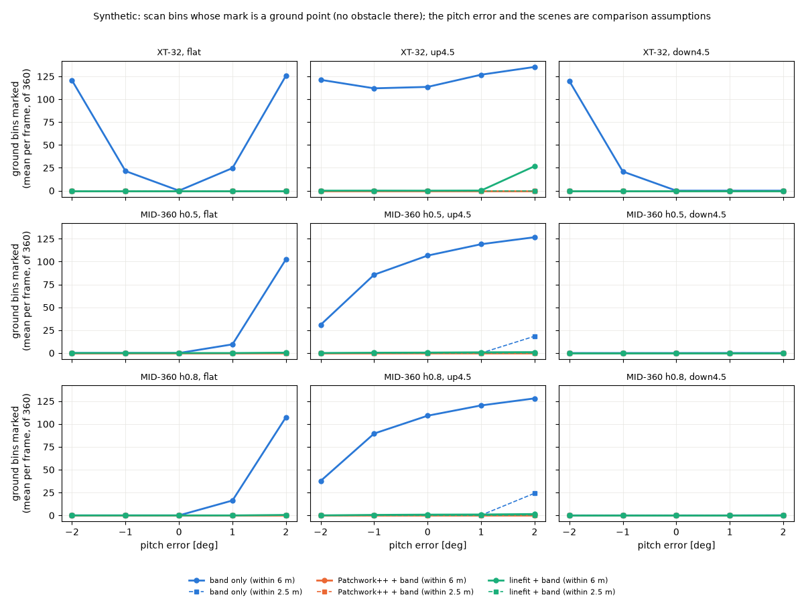

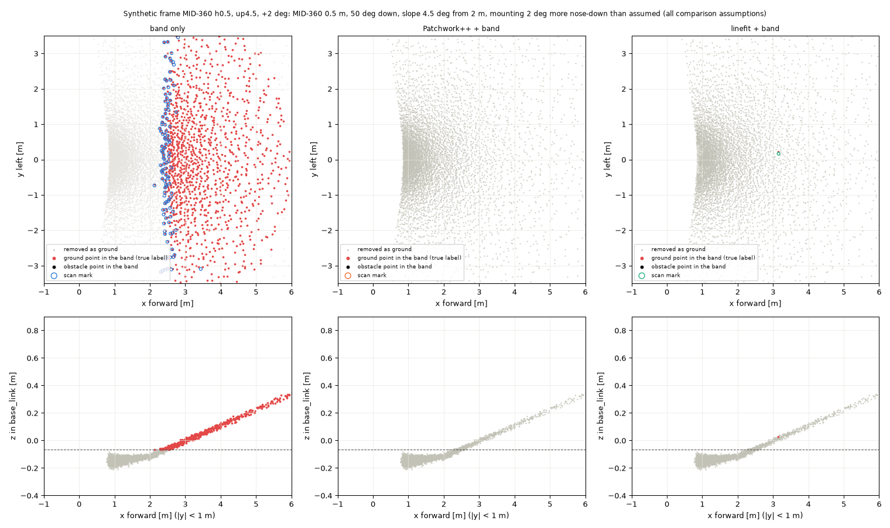

### 3.4 結果：物（平らな地面）

物の名前の末尾は base_link からの距離。XT-32 は低い物が近いと見えない（`lidar_xt32_spec.md` の表）ので、写った物の数が少ない。

| センサー | 方式 | 誤差 | 全部の枚で印になった物 / 写った物 | 印にならない枚があった物（印になった枚 / 写った枚） | 前の地面の印に隠れた物（1 枚あたりの方位） | 縁の距離の誤差（物ごとの中央値の最小〜最大） | 帯の中の障害物の点のうち地面にされた割合 |
|---|---|---|---|---|---|---|---|
| XT-32 | 帯だけ | -2° | 6/6 | なし | なし | -0.06〜-0.04 m | 0 % |
| XT-32 | 帯だけ | +0° | 7/7 | なし | なし | -0.04〜-0.01 m | 0 % |
| XT-32 | 帯だけ | +2° | 4/7 | box30_4.3m（0/20）、leg_c_3.9m（4/20）、leg_d_4.0m（0/20） | box30_4.3m（5.7）、leg_c_3.9m（2.8）、leg_d_4.0m（3.0） | -0.04〜+0.01 m | 0 % |
| XT-32 | Patchwork++＋帯 | -2° | 6/6 | なし | なし | -0.06〜-0.04 m | 0 % |
| XT-32 | Patchwork++＋帯 | +0° | 7/7 | なし | なし | -0.04〜-0.01 m | 1 % |
| XT-32 | Patchwork++＋帯 | +2° | 7/7 | なし | なし | -0.04〜+0.03 m | 16 % |
| XT-32 | linefit＋帯 | -2° | 6/6 | なし | なし | -0.06〜-0.04 m | 0 % |
| XT-32 | linefit＋帯 | +0° | 7/7 | なし | なし | -0.04〜-0.01 m | 0 % |
| XT-32 | linefit＋帯 | +2° | 7/7 | なし | なし | -0.04〜+0.01 m | 12 % |
| MID-360 h0.5 | 帯だけ | -2° | 9/10 | box15_2.4m（10/20） | なし | -0.06〜+0.03 m | 0 % |
| MID-360 h0.5 | 帯だけ | +0° | 10/10 | なし | なし | -0.05〜-0.01 m | 0 % |
| MID-360 h0.5 | 帯だけ | +2° | 10/10 | なし | cone_3.6m（0.9）、box30_4.3m（1.9） | -0.05〜+0.01 m | 0 % |
| MID-360 h0.5 | Patchwork++＋帯 | -2° | 9/10 | box15_2.4m（10/20） | なし | -0.06〜+0.03 m | 30 % |
| MID-360 h0.5 | Patchwork++＋帯 | +0° | 10/10 | なし | なし | -0.05〜+0.01 m | 8 % |
| MID-360 h0.5 | Patchwork++＋帯 | +2° | 10/10 | なし | なし | -0.05〜+0.02 m | 43 % |
| MID-360 h0.5 | linefit＋帯 | -2° | 9/10 | box15_2.4m（9/20） | なし | -0.06〜+0.03 m | 3 % |
| MID-360 h0.5 | linefit＋帯 | +0° | 10/10 | なし | なし | -0.05〜-0.00 m | 6 % |
| MID-360 h0.5 | linefit＋帯 | +2° | 10/10 | なし | なし | -0.05〜+0.01 m | 12 % |
| MID-360 h0.8 | 帯だけ | -2° | 9/10 | box15_2.4m（19/20） | なし | -0.06〜+0.00 m | 0 % |
| MID-360 h0.8 | 帯だけ | +0° | 10/10 | なし | なし | -0.05〜+0.00 m | 0 % |
| MID-360 h0.8 | 帯だけ | +2° | 10/10 | なし | cone_3.6m（1.5）、box30_4.3m（2.0） | -0.06〜-0.00 m | 0 % |
| MID-360 h0.8 | Patchwork++＋帯 | -2° | 9/10 | box15_2.4m（19/20） | なし | -0.06〜+0.00 m | 28 % |
| MID-360 h0.8 | Patchwork++＋帯 | +0° | 10/10 | なし | なし | -0.05〜+0.06 m | 35 % |
| MID-360 h0.8 | Patchwork++＋帯 | +2° | 10/10 | なし | なし | -0.06〜+0.06 m | 42 % |
| MID-360 h0.8 | linefit＋帯 | -2° | 9/10 | box15_2.4m（19/20） | なし | -0.06〜+0.00 m | 4 % |
| MID-360 h0.8 | linefit＋帯 | +0° | 10/10 | なし | なし | -0.05〜+0.00 m | 7 % |
| MID-360 h0.8 | linefit＋帯 | +2° | 10/10 | なし | なし | -0.06〜+0.02 m | 13 % |

### 3.5 結果：物（4.5° の上り坂の上）

| センサー | 方式 | 誤差 | 全部の枚で印になった物 / 写った物 | 印にならない枚があった物（印になった枚 / 写った枚） | 前の地面の印に隠れた物（1 枚あたりの方位） | 縁の距離の誤差（物ごとの中央値の最小〜最大） | 帯の中の障害物の点のうち地面にされた割合 |
|---|---|---|---|---|---|---|---|
| XT-32 | 帯だけ | -2° | 6/6 | なし | なし | -0.06〜-0.04 m | 0 % |
| XT-32 | 帯だけ | +0° | 6/7 | box30_4.3m（0/20） | box30_4.3m（6.0） | -0.05〜-0.01 m | 0 % |
| XT-32 | 帯だけ | +2° | 3/7 | cone_3.6m（0/20）、box30_4.3m（0/20）、leg_c_3.9m（0/20）、leg_d_4.0m（0/20） | cone_3.6m（2.1）、box30_4.3m（5.8）、leg_c_3.9m（3.0）、leg_d_4.0m（2.9） | -0.04〜-0.01 m | 0 % |
| XT-32 | Patchwork++＋帯 | -2° | 6/6 | なし | なし | -0.06〜-0.04 m | 4 % |
| XT-32 | Patchwork++＋帯 | +0° | 7/7 | なし | なし | -0.05〜-0.01 m | 19 % |
| XT-32 | Patchwork++＋帯 | +2° | 7/7 | なし | なし | -0.04〜+0.04 m | 18 % |
| XT-32 | linefit＋帯 | -2° | 6/6 | なし | なし | -0.06〜-0.04 m | 0 % |
| XT-32 | linefit＋帯 | +0° | 7/7 | なし | なし | -0.05〜-0.01 m | 11 % |
| XT-32 | linefit＋帯 | +2° | 5/7 | cone_3.6m（13/20）、box30_4.3m（15/20） | cone_3.6m（1.2）、box30_4.3m（2.7） | -0.04〜+0.02 m | 11 % |
| MID-360 h0.5 | 帯だけ | -2° | 10/10 | なし | なし | -0.06〜-0.00 m | 0 % |
| MID-360 h0.5 | 帯だけ | +0° | 10/10 | なし | cone_3.6m（0.9）、box30_4.3m（2.0） | -0.06〜-0.02 m | 0 % |
| MID-360 h0.5 | 帯だけ | +2° | 9/10 | cone_3.6m（0/20） | cone_3.6m（6.0）、box30_4.3m（2.0） | -0.06〜-0.01 m | 0 % |
| MID-360 h0.5 | Patchwork++＋帯 | -2° | 10/10 | なし | なし | -0.05〜-0.00 m | 28 % |
| MID-360 h0.5 | Patchwork++＋帯 | +0° | 9/10 | box15_2.4m（19/20） | なし | -0.05〜+0.01 m | 41 % |
| MID-360 h0.5 | Patchwork++＋帯 | +2° | 10/10 | なし | なし | -0.06〜+0.01 m | 46 % |
| MID-360 h0.5 | linefit＋帯 | -2° | 10/10 | なし | なし | -0.06〜-0.00 m | 5 % |
| MID-360 h0.5 | linefit＋帯 | +0° | 10/10 | なし | なし | -0.06〜+0.00 m | 10 % |
| MID-360 h0.5 | linefit＋帯 | +2° | 10/10 | なし | なし | -0.06〜-0.01 m | 13 % |
| MID-360 h0.8 | 帯だけ | -2° | 10/10 | なし | なし | -0.07〜-0.02 m | 0 % |
| MID-360 h0.8 | 帯だけ | +0° | 10/10 | なし | cone_3.6m（1.4）、box30_4.3m（2.0） | -0.05〜-0.01 m | 0 % |
| MID-360 h0.8 | 帯だけ | +2° | 8/10 | cone_3.6m（0/20）、leg_c_3.9m（2/20） | cone_3.6m（6.0）、box30_4.3m（1.9）、leg_c_3.9m（2.8）、leg_d_4.0m（1.0） | -0.05〜-0.00 m | 0 % |
| MID-360 h0.8 | Patchwork++＋帯 | -2° | 10/10 | なし | なし | -0.06〜-0.02 m | 5 % |
| MID-360 h0.8 | Patchwork++＋帯 | +0° | 10/10 | なし | なし | -0.05〜+0.01 m | 20 % |
| MID-360 h0.8 | Patchwork++＋帯 | +2° | 10/10 | なし | なし | -0.04〜+0.02 m | 42 % |
| MID-360 h0.8 | linefit＋帯 | -2° | 10/10 | なし | なし | -0.06〜-0.02 m | 5 % |
| MID-360 h0.8 | linefit＋帯 | +0° | 10/10 | なし | なし | -0.05〜+0.00 m | 10 % |
| MID-360 h0.8 | linefit＋帯 | +2° | 10/10 | なし | なし | -0.04〜+0.01 m | 11 % |

### 3.6 結果：縁石・段差（印になった枚数 / 20。pitch の誤差 −2° / 0° / +2°。— は点が写らなかった）

| センサー | 方式 | 物 | 8 cm | 10 cm | 12 cm | 15 cm |
|---|---|---|---|---|---|---|
| XT-32 | 帯だけ | 前の縁石 | — / — / 20 | — / — / 20 | — / — / 20 | — / 20 / 20 |
| XT-32 | 帯だけ | 左の段差 | 20 / 0 / 20 | 20 / 20 / 20 | 20 / 20 / 20 | 20 / 20 / 20 |
| XT-32 | Patchwork++＋帯 | 前の縁石 | — / — / 0 | — / — / 0 | — / — / 0 | — / 20 / 20 |
| XT-32 | Patchwork++＋帯 | 左の段差 | 0 / 0 / 0 | 0 / 0 / 0 | 0 / 0 / 0 | 20 / 20 / 20 |
| XT-32 | linefit＋帯 | 前の縁石 | — / — / 0 | — / — / 20 | — / — / 20 | — / 20 / 20 |
| XT-32 | linefit＋帯 | 左の段差 | 5 / 0 / 2 | 20 / 20 / 20 | 20 / 20 / 20 | 20 / 20 / 20 |
| MID-360 h0.5 | 帯だけ | 前の縁石 | 0 / 9 / 20 | 0 / 20 / 20 | 0 / 20 / 20 | 0 / 20 / 20 |
| MID-360 h0.5 | 帯だけ | 左の段差 | 5 / 17 / 20 | 20 / 20 / 20 | 20 / 20 / 20 | 20 / 20 / 20 |
| MID-360 h0.5 | Patchwork++＋帯 | 前の縁石 | 0 / 0 / 0 | 0 / 0 / 0 | 0 / 10 / 8 | 0 / 20 / 20 |
| MID-360 h0.5 | Patchwork++＋帯 | 左の段差 | 0 / 1 / 0 | 0 / 4 / 4 | 0 / 4 / 1 | 0 / 7 / 4 |
| MID-360 h0.5 | linefit＋帯 | 前の縁石 | 0 / 5 / 20 | 0 / 20 / 20 | 0 / 20 / 20 | 0 / 20 / 20 |
| MID-360 h0.5 | linefit＋帯 | 左の段差 | 0 / 0 / 1 | 0 / 7 / 17 | 13 / 20 / 20 | 20 / 20 / 20 |
| MID-360 h0.8 | 帯だけ | 前の縁石 | 0 / 14 / 20 | 0 / 20 / 20 | 0 / 20 / 20 | 0 / 20 / 20 |
| MID-360 h0.8 | 帯だけ | 左の段差 | 4 / 20 / 20 | 20 / 20 / 20 | 20 / 20 / 20 | 20 / 20 / 20 |
| MID-360 h0.8 | Patchwork++＋帯 | 前の縁石 | 0 / 0 / 0 | 0 / 2 / 2 | 0 / 20 / 19 | 0 / 20 / 20 |
| MID-360 h0.8 | Patchwork++＋帯 | 左の段差 | 0 / 1 / 0 | 5 / 5 / 6 | 11 / 16 / 9 | 17 / 20 / 20 |
| MID-360 h0.8 | linefit＋帯 | 前の縁石 | 0 / 11 / 20 | 0 / 20 / 20 | 0 / 20 / 20 | 0 / 20 / 20 |
| MID-360 h0.8 | linefit＋帯 | 左の段差 | 0 / 2 / 16 | 2 / 20 / 20 | 19 / 20 / 20 | 20 / 20 / 20 |

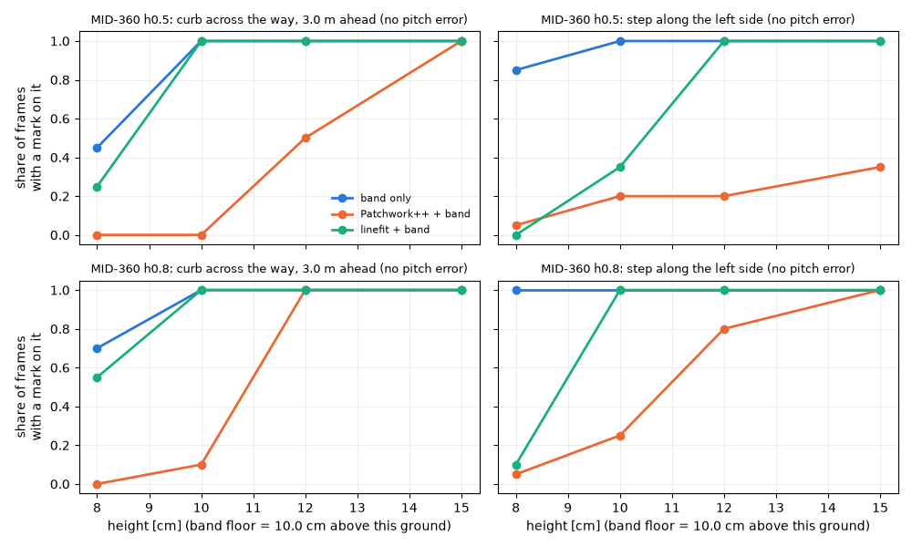

### 3.7 処理の時間（ワークステーション、Python から呼んだ地面分割だけ）

| センサー | 方式 | 地面分割の 1 枚あたりの時間（条件ごとの平均の最小〜最大、ms） |
|---|---|---|
| XT-32 | Patchwork++＋帯 | 1.9〜2.4 |
| XT-32 | linefit＋帯 | 1.8〜3.6 |
| MID-360 h0.5 | Patchwork++＋帯 | 0.5〜0.6 |
| MID-360 h0.5 | linefit＋帯 | 0.8〜2.7 |
| MID-360 h0.8 | Patchwork++＋帯 | 0.4〜0.6 |
| MID-360 h0.8 | linefit＋帯 | 0.9〜1.4 |

### 3.8 合成の結果から読めること（事実）

- 帯だけの地面の誤検知は、取り付けの誤差と坂で起きる。誤差の向きで起きる場所が変わる（XT-32 は前と後ろの両方、MID-360 は前だけを見るので + の誤差のとき）
- 2 つの地面分割は、この場面（完全な平面と坂）では地面の誤検知をほぼなくした。linefit は max_slope 0.1（約 5.7°）を超える傾き（坂 4.5°＋誤差 2°）で地面と見なさない所が残った
- コーン・脚・0.30 m の箱・0.15 m の箱は、帯だけで印になった枚では、地面分割の後もほぼ印が残った（例外は 1 章の 2 件で、それぞれ 1 枚）。XT-32 の上り坂 +2° の linefit では、残った地面の印が 3.6 m のコーンと 4.3 m の箱の手前に出た（物の印は 13/20・15/20 枚）
- 縁石・段差は、高さが帯の下限（この地面から 10.0 cm）に近いほど、地面分割で消えやすい。Patchwork++ は既定の th_dist 0.125 m より低い物を地面にしやすい。上が平らな段差（歩道の縁のような形）は、15 cm でも 0.5 m の取り付けで誤差 0°・+2° のとき 7/20・4/20 枚しか印にならなかった（−2° は 0/20、帯だけは 20/20）
- 帯だけでも、−2° の誤差では前の物が低く見え、MID-360 の前の縁石は 15 cm でも印にならず、0.15 m の箱（2.4 m）も 0.5 m の取り付けで 10/20 枚になった
- 縁の距離の誤差は −0.07〜+0.06 m。帯だけでも負に寄るのは、雑音のある点の中から一番近い点を選ぶため（推測：σ 2 cm の最小値の偏り）

## 4. 実データ（XT-32、正解なし）

### 4.1 記録と区間

- 記録：x86 の車載 PC の `gouda_data/records/20261014_175847`（2026-10-14 夕方、人が行った地図作成の走行。屋外。`2026-10-14_evening_maps_rosbag.txt`）。/sensors/xt32/points（10 Hz）。2026-11-03・11-07 の rosbag は /tf_static があるが、記録によると屋内の通路（`2026-11-03_vehicle_measurements`）か場所が不明（11-07）なので使わなかった
- 区間（記録の始まりからの秒）：坂を含むよう、GLIM の軌跡（同じ走行の地図の `traj_lidar.txt`）の経路の勾配から選んだ
  - W1：256〜284 s（281 枚）。勾配 約 1〜2° → 8° の上り → 0.5°
  - W2：570〜596 s（261 枚）。勾配 約 −3.5° → −0.3° → −8° の下り → −1°
- 写し方：車載 PC では `tail -c`・`head -c`・`dd`（読むだけ）で、索引と区間のバイトだけを写し、ワークステーションで `tools/mcap_cut.py` で MCAP に組み直した（W1 468.7 MB・382 s、W2 435.4 MB・356 s）。写した bag の場所はリポジトリに書かない
- TF：この記録には /tf_static がない。2026-11-07 の記録（`20261107_005310` の bag_01）の /tf_static を使った（base_link → xt32_link (−0.07, 0.14, 1.015) m・yaw 100°、base_link → base_footprint z −0.165 m）。2026-10-14 の取り付けがこれと同じかは確かめていない（2026-10-14 の /config の値は軸 `+x left, -y forward, +z up`・yaw 0.1745 rad で、回転は合う。位置は未確認）
- 設定：3.1 と同じ帯と 6.0 m、地面分割の sensor_height 1.18 m、その他は既定（2.3）

### 4.2 結果

「消えた印」= 帯だけでは印があり、地面分割の後は印がないか 0.10 m より遠くなった方位。1 枚あたりの値。

| 区間 | 項目 | 帯だけ | Patchwork++＋帯 | linefit＋帯 |
|---|---|---|---|---|
| W1 | 印のある方位（2.5 m 以内 / 6 m 以内、平均） | 121.2 / 282.7 | 121.2 / 252.8 | 121.2 / 261.0 |
| W1 | 消えた印（2.5 m 以内） | — | 全枚数で 0 | 全枚数で 0 |
| W1 | 消えた印（6 m 以内：平均・中央値・p95・最大） | — | 52.2・53・105・159（253/281 枚であり） | 30.5・23・86・161（212/281 枚） |
| W1 | 帯の中で地面にされた点（平均・中央値） | — | 4354・4522 | 1091・590 |
| W1 | 消えた印のうち近くの一番低い点群から 0.15 m 以上 | — | 281/14675（1.9 %） | 150/8568（1.8 %） |
| W1 | 消えた印の距離（p5・中央値・p95） | — | 2.70・3.54・5.46 m | 3.38・3.87・5.65 m |
| W1 | 地面分割の時間（中央値・p95・最大） | — | 3.2・3.9・4.7 ms | 4.9・6.9・13.6 ms |
| W2 | 印のある方位（2.5 m 以内 / 6 m 以内、平均） | 118.6 / 306.3 | 118.6 / 283.8 | 118.6 / 291.0 |
| W2 | 消えた印（2.5 m 以内） | — | 全枚数で 0 | 全枚数で 0 |
| W2 | 消えた印（6 m 以内：平均・中央値・p95・最大） | — | 55.8・52・98・149（260/261 枚） | 22.8・10・76・136（164/261 枚） |
| W2 | 帯の中で地面にされた点（平均・中央値） | — | 4547・4503 | 921・248 |
| W2 | 消えた印のうち近くの一番低い点群から 0.15 m 以上 | — | 717/14553（4.9 %） | 101/5943（1.7 %） |
| W2 | 消えた印の距離（p5・中央値・p95） | — | 2.64・3.22・5.13 m | 3.38・3.82・5.56 m |
| W2 | 地面分割の時間（中央値・p95・最大） | — | 3.5・4.0・6.9 ms | 4.9・7.7・32.6 ms |

- 「近くの一番低い点群」：同じ方位と両隣の方位で、印の距離 ±1.0 m にある全部の点の z の 5 % 点。地面分割とは独立の目安で、正解ではない
- Patchwork++ が枚ごとに更新する sensor_height は、W1 で 1.14 m（最初）・1.05 m（中央値）、W2 で 1.03 m（最初）→ 0.79 m（最後）だった（設定は 1.18 m）

### 4.3 図（人が見るためのもの）

- 時間ごとの消えた印の数と、経路の勾配：

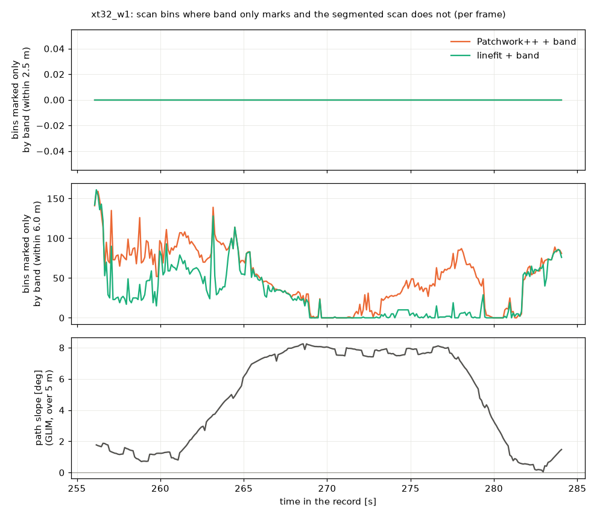

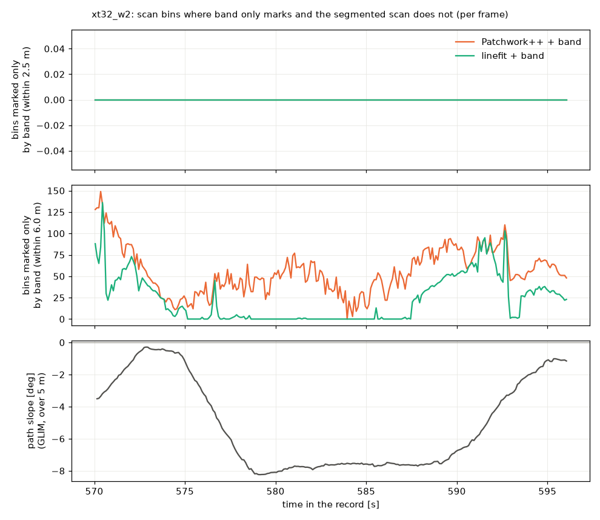

- 上から見た集計（base_link。左：帯だけの全部の印、中・右：地面分割で消えた印。0.1 m の升で枚数×方位を数えた。黒い四角は足跡 PRM-69、破線は 2.5 m と 6 m）：

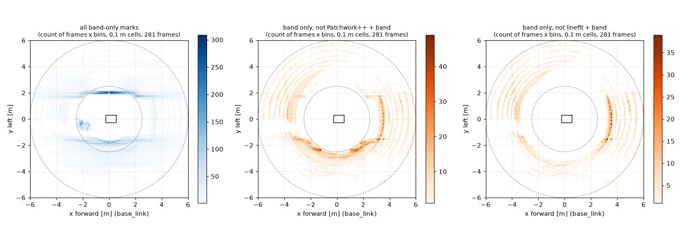

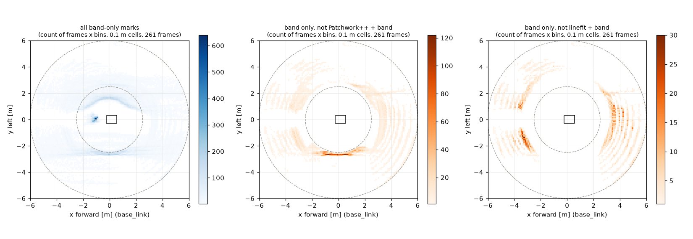

- 消えた印のうち、近くの一番低い点群から 0.15 m 以上のもの（色）の場所。見落としの候補として人が見る所：

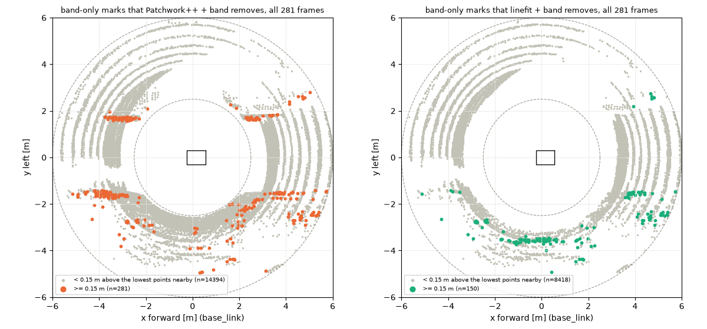

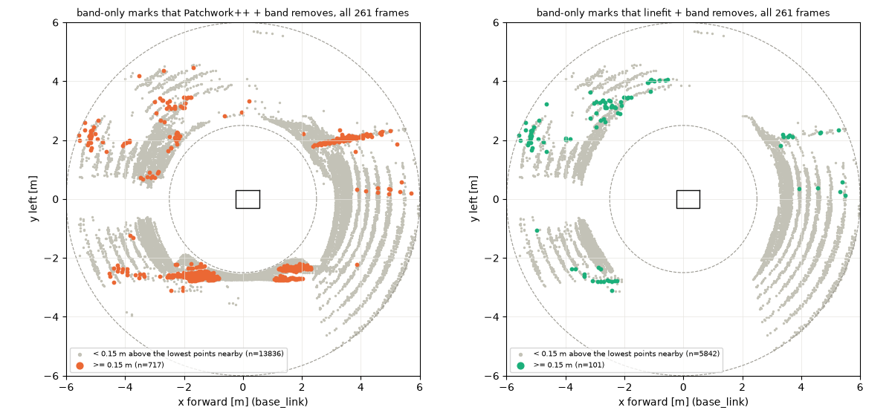

- 消えた印の高さの分布：`figures/xt32_w1_mark_heights.png`、`figures/xt32_w2_mark_heights.png`
- 1 枚の点群（区間で消えた印が一番多かった枚。上：上から、下：水平距離と高さ。灰＝地面分割が地面とした点、黒＝帯に入って残った点、色＝帯に入って地面にされた点、青い丸＝消えた帯だけの印、破線＝帯）：

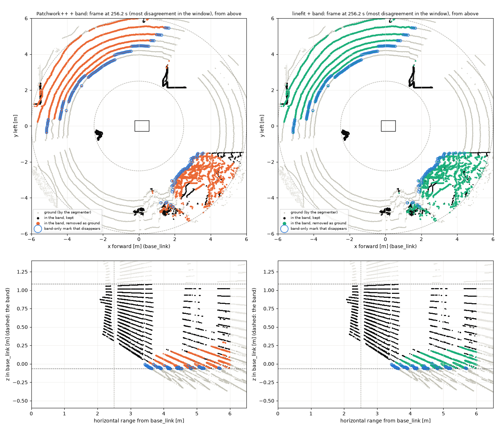

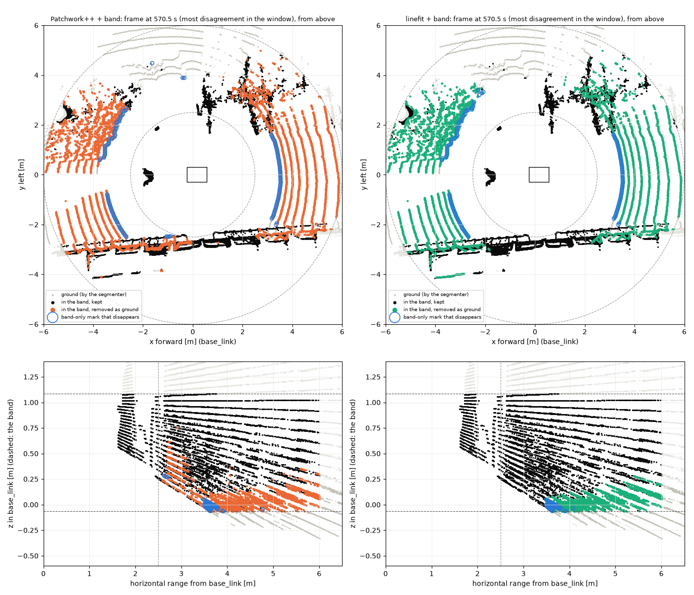

### 4.4 実データから読めること

- 事実：2.5 m 以内の印は、2 区間とも 3 方式で同じだった（消えた印は 2.5 m 以内に 1 つもなく、距離の 5 % 点は 2.64〜3.38 m）。XT-32 は平らな所で約 4 m より近い地面が見えない（`lidar_xt32_spec.md`）
- 計算：今の costmap は 2.5 m より遠い印を付けない（雛形の obstacle_max_range）ので、この 2 区間では、どの方式でも costmap の印は変わらない。PRM-125 を 2.5 m より大きくすると変わる（#24 の案と関係する）。Nav2 で確かめてはいない
- 事実：linefit の消えた印は、8° の坂の途中（W1 267〜277 s、W2 578〜587 s）でほぼ 0 で、坂の前後と区間の最初に多かった。Patchwork++ は坂の途中でも 1 枚あたり 0〜85 あった（時間の図）
- 事実：区間の最初の 1 枚（W1 256.2 s、W2 570.5 s。消えた印が一番多かった枚）では、3〜6 m の点の筋が、距離とともに base_link の z −0.05 m から +0.3 m まで上がっていて、帯の中に入っていた（1 枚の図の下の段）
- 事実：W2 では、Patchwork++ が消した印のうち 0.15 m 以上のものが、左右の約 2 m の所に筋のように並んだ（上の「高い消えた印」の図）。同じ所に、帯だけの印の筋がある（集計の図の左）
- 推測：この筋は通路の両側の低い縁（縁石・植え込みの縁など）で、Patchwork++ がその下の部分を地面にした可能性がある。場所に行って確かめておらず、何の物かは分からない。人が図と現場で確かめること
- 事実：帯だけの 2.5 m 以内の印（1 枚あたり約 120 方位）は、どの方式でも同じだった。W1 の 3 枚（0・100・200 枚目）の 5〜95 % 点で、印は 1.65〜2.47 m、高さは base_link で 0.27〜1.08 m にあった。何の物か（周りの人・壁・手すりなど）は確かめていない

## 5. 実行したコマンドと結果

場所は「ワークステーション」（新しい作業場所、venv の中）と「車載 PC」（x86。読むだけ）。対象のコミットは 9c449b5 の作業ツリー＋この `tools/`（未コミット）。

| 場所 | コマンド | 結果 |
|---|---|---|
| ワークステーション | `python3 -m venv venv` と `pip install pypatchworkpp==1.4.1 linefit==1.1.0 numpy matplotlib mcap mcap-ros2-support zstandard lz4 pytest` | 入った。`pip freeze`：contourpy 1.4.0、linefit 1.1.0、lz4 4.4.5、matplotlib 3.11.2、mcap 1.6.0、mcap-ros2-support 0.6.0、numpy 2.5.4、pypatchworkpp 1.4.1、pytest 9.2.0、zstandard 0.25.0 ほか。Python 3.12.3 |
| ワークステーション | `python -m pytest -q -p no:cacheprovider tools/tests` | 18 passed（p2l 7、合成 7、mcap_cut 2、地面分割の束縛 2）。途中の実行で失敗が 2 件あった。原因の分類（1.6）：実装（写しが +π の端の点で例外を出していた。上流は配列の外に書くだけで出力に入らないので、捨てるように直した）と試験（テストの点が float32 の丸めを考えていなかった。float32 の 1.085 が捨てられることを確かめる点を足した）。合否の基準は変えていない |
| ワークステーション | `python -I tools/run_synth.py out_synth --frames 20 --warmup 5` | 135 条件（3 センサー × 9 場面 × 5 誤差）、41 s |
| ワークステーション | `python -I tools/summarize_synth.py out_synth figs_synth` | 3 章の表と `figures/synth_*.png` |
| 車載 PC | `ls`、`du -sh`、`stat -c %s`、`awk` で `metadata.yaml` のトピックと件数を読む、`uptime`（負荷 0.25） | rosbag の候補 6 本を見た（4.1）。記録の置き場（gouda_data）は Gouda の作業場所の下にあり、そこでは読むことと写すことだけをした |
| 車載 PC → ワークステーション | `tail -c 33554432 <bag>`、`head -c 4096 <bag>`、`dd if=<bag> iflag=skip_bytes,count_bytes skip=<S> count=<C>` を手元の端末を経由してワークステーションへ流した。`cat traj_lidar.txt` も同じ | W1・W2 と /tf_static の区間（2 chunk、3.4 MB）を写した。速さは約 1.2〜1.7 MB/s |
| ワークステーション | `python -I tools/mcap_cut.py` の index・range・assemble | W1 281 chunk、W2 261 chunk。/tf_static を mcap-ros2-support で読めた |
| ワークステーション | `python -I tools/run_bag.py <W1> out_bag xt32_w1 --tf-bag <tf> --t-origin-ns 1791968328321858235 --traj <traj>`（W2 も同じ） | 4 章の表と `figures/xt32_*.png`。1 区間 13 s |
| ワークステーション | `python -I tools/run_bag.py <tf の区間>`（--tf-bag なし） | bag の中の /tf_static を使う道筋が動いた（1 枚、xt32_link、1.18 m） |

車載 PC では Gouda の起動・停止、ros2 のコマンド、ビルドはしていない。書き込みもしていない。

## 6. 限界と確かめられなかった点

- 合成の場面の値の多く（坂、縁石・段差・物の寸法、取り付けの誤差、MID-360 の取り付けと走査の形、XT-32 の雑音）は比較用の仮定で、設計の値ではない。地面は完全な平面と坂で、草・砂利・凹凸・水たまり・車体による遮りは入れていない
- 合成の 1 枚ごとは静止した 1 枚で、近づきながら見ることは入れていない。2.5 m 以内の結果は置いた距離に依る
- 地面分割の設定は既定値に近い 1 通りだけ。sensor_height 以外を調整した場合は試していない（例：Patchwork++ の th_dist、linefit の max_slope・max_dist_to_line）
- 実データは XT-32 の 1 本の記録の 2 区間（54 s）だけ。正解がないので、消えた印が地面か物かは決めていない。0.15 m の目安も正解ではない
- 実データの TF は別の日の /tf_static。2026-10-14 の取り付けの位置は未確認
- MID-360 の実データはない（T04・T08 の bag がまだない）。MID-360 の結果は合成だけ
- 時間はワークステーションでの Python からの呼び出し。車載 PC と ROS 2 の node での負荷は測っていない
- XT-32 のデータシートは原本未照合（雑音・最小距離）
- base_link を重力の代わりにした。坂の上で重力に合わせた場合（IMU、#80）は試していない
- 地面分割は低い物の見落としを生む。安全に関わる判断（どの高さの物を必ず印にするか）は人が決める

## 7. MID-360 の bag が手に入ったら

同じ道具で回せる。MID-360 の取り付けは bag の /tf_static（mid360_link）から読む。

```
python -I tools/mcap_cut.py index <tail> <size>            # 区間を選ぶ
python -I tools/mcap_cut.py range <tail> <size> <t0> <t1>  # 写すバイトの範囲
python -I tools/mcap_cut.py assemble <head> <tail> <size> <range> <cut.mcap>
python -I tools/run_bag.py <cut.mcap> <out> mid360_t04 --topic /sensors/mid360/points --min-range 0.2
```

- /tf_static がない bag は `--tf-bag` で別の bag の /tf_static を使う。sensor_height は base_footprint からのセンサーの z を使う
- 経路の勾配を重ねるときは `--traj <traj_lidar.txt> --t-origin-ns <bag の開始の ns>`

## 8. 気づいた点（issue の候補。登録はしていない）

- 上流の pointcloud_to_laserscan 2.0.2：+π の近く（1.36×10⁻⁷ rad 以内）の点で配列の外を読み書きする（2.1）。Gouda の設定（−π〜π、π/180）で起きうる
- Patchwork++ の既定の min_range 2.7 m のままでは、MID-360 の近い地面は分割されない（範囲外は地面にしない）。MID-360 に使うなら min_range を決める必要がある
- Patchwork++ は sensor_height を走行中に更新する（W2 で 1.18 m の設定から 0.79 m まで動いた）。坂や周りの形で変わる
- linefit の既定の max_slope 0.1 は約 5.7°。記録の坂（5 m ごとに 8° まで）より小さい
- 2026-10-14 の地図作成の rosbag には /tf_static がない
